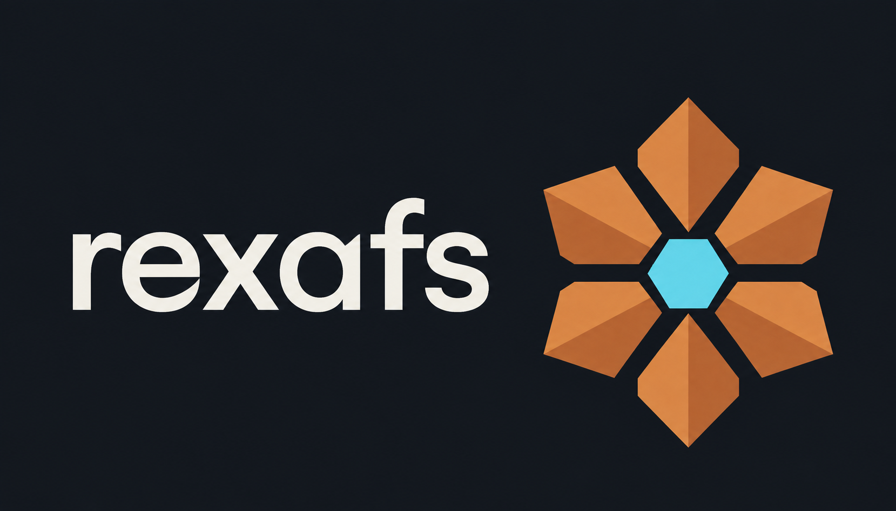

# rexafs

**[Download the latest desktop binaries](https://github.com/Ameyanagi/rexafs/releases/latest)** ·
[User documentation](https://rexafs.com/docs/getting-started/) ·
[Release build workflow](https://github.com/Ameyanagi/rexafs/actions/workflows/release-build.yml)



**Open-source X-ray absorption analysis. Fast. Small. Capable.**

rexafs is free and open source under [MIT](LICENSE-MIT) or
[Apache-2.0](LICENSE-APACHE), built for fast processing in a small package.
Work across formats and platforms: import text/XDI spectra and CIF/XYZ structures,
then export CSV data and SVG/PNG figures. The desktop and Rust library support
scattering calculations, joint fits and large measurement series; Python and
TypeScript expose spectrum processing. Browser analysis is in development, with
a [processing preview](https://rexafs.com/app/).

The [public website](https://rexafs.com/) has installation guides, illustrated
workflows and API references.

Developed under the codename **xraytsubaki**, inspired by the camellia. The `r`
in **rexafs** stands for both **Rust** and **reinventing the wheel** for EXAFS
analysis. The project began with the need to process large in-situ measurement
series.

## Choose your installation

| Use case | Install | Start here |
|---|---|---|
| Desktop analysis, fitting and plots | [Download the latest release](https://github.com/Ameyanagi/rexafs/releases/latest) | [Desktop installation](#install-the-desktop) |
| Spectrum processing in the browser | [Analyze a spectrum](https://rexafs.com/app/) | [WASM scope and limitations](website/src/content/docs/docs/libraries/webassembly.md) |
| ReFEFF in the browser | [Calculate scattering](https://rexafs.com/app/scattering/) | [ReFEFF 0.4.0 integration](doc/webassembly.md#refeff-040-integration) |
| Python / Jupyter with NumPy | `uv add rexafs` | [Python guide](py-rexafs/README.md) |
| TypeScript / JavaScript, Node or browser | `bun add rexafs` | [TypeScript guide](js-rexafs/README.md) |
| Rust applications | `cargo add rexafs` | [Rust API](https://docs.rs/rexafs) |

Python supports CPython 3.10–3.14. Node requires version 22 or newer.
Prebuilt Python wheels and the npm Wasm package do not require a Rust compiler.
Browser processing uses the source-checkout engine; scattering loads ReFEFF
0.4.0 separately. Both operate on local files without uploading them. Website
deployment is separate from the versioned packages.
Use a Python virtual environment to keep project dependencies separate:

```bash
uv init --python 3.12 my-analysis
cd my-analysis
uv add rexafs numpy
uv run python
```

`uv add` records dependencies in `pyproject.toml` and `uv.lock`; `uv run` keeps
the project's `.venv` synchronized before starting Python. Commit the project
files and lockfile with your analysis code to record its dependency resolution.

In VS Code, select this environment with **Python: Select Interpreter**; in
Jupyter, select its kernel. The Python package includes `py.typed` and type
stubs; npm includes TypeScript declarations. Member completion and hover help
are available without extra rexafs editor plugins.

The guides in this checkout describe the 0.2.5 keyword/options constructors and
`XrayFFTR` bindings. Version 0.2.4 supports the basic pipeline below; use its
method selectors and field assignments when targeting that version. Rust 0.2.5
also accepts `AUTOBK` and `PrePostEdge` directly in spectrum setters, without enum
wrappers. Use the [download page](https://rexafs.com/download/) to check which
packages are currently published.

## Install the desktop

Open the [latest release](https://github.com/Ameyanagi/rexafs/releases/latest)
and choose the package for your operating system and processor. This link follows
each new stable release automatically.

| Platform | Architecture | Package and installation |
|---|---|---|
| macOS | Apple Silicon (ARM64) | Open the `aarch64-apple-darwin.dmg` installer and drag rexafs to Applications; a ZIP is also available. |
| Windows preview | Intel / AMD (x86-64) | Run the `x86_64-pc-windows-msvc-setup.exe` installer, or extract the portable ZIP. |
| Windows preview | ARM64 | Run the `aarch64-pc-windows-msvc-setup.exe` installer, or extract the portable ZIP. Requires Windows 11. |
| Linux preview | Intel / AMD (x86-64) | Extract the `x86_64-unknown-linux-gnu.tar.gz` archive and run `./rexafs` from its folder. |
| Linux preview | ARM64 | Extract the `aarch64-unknown-linux-gnu.tar.gz` archive and run `./rexafs` from its folder. |

From 0.2.12, macOS desktop releases and Python wheels require Apple Silicon.
Intel Mac support ends with [0.2.11](https://github.com/Ameyanagi/rexafs/releases/tag/v0.2.11);
those historical downloads remain available. Nightly also requires Apple Silicon.

Asset names begin with `rexafs-` and the release version. Keep portable folders
together: they contain the executable, resources, examples and licenses. The
desktop does not require Rust or Python to be installed. Linux uses the Ubuntu
24.04 runtime baseline and requires a graphical session and Vulkan driver; see
the [Linux requirements](doc/installing.md#linux-portable-archive).

Windows ARM64 runs rexafs and ReFEFF natively; its bundled x64 FEFF10 helper
uses Windows 11 emulation. Linux ARM64 runs both engines natively.

The [release build workflow](https://github.com/Ameyanagi/rexafs/actions/workflows/release-build.yml)
builds and tests optimized desktop binaries with `cargo build --release`.
The [publication workflow](https://github.com/Ameyanagi/rexafs/actions/workflows/publish.yml)
stages the verified downloads, and the
[Mac signing workflow](https://github.com/Ameyanagi/rexafs/actions/workflows/sign-macos.yml)
signs and notarizes Mac installers. Release pages include checksums and validation
details. See [Windows installation](doc/windows-installers.md),
[offline setup](doc/installing.md#offline-installation) and the
[release runbook](doc/releasing.md).

## What is available

| Surface | Implemented scope |
|---|---|
| Rust core | Normalization, AUTOBK, FFT/IFFT, parallel groups, alignment/rebinning/merging, LCF/PCA, structures, path fitting and joint/independent fits |
| Python | Spectrum stages and configuration with NumPy results; QAS file reader |
| JavaScript / TypeScript | Spectrum stages and configuration through Wasm in Node and browsers |
| Desktop | Import, processing, structures and path selection, fitting, project persistence and publication exports |

Optional Rust integrations include [ReFEFF](https://crates.io/crates/refeff), FEFF10,
structure databases and plotting. The Python and JavaScript packages expose the
small processing API; they do not yet expose all Rust fitting and structure APIs.
See the [WebAssembly assessment](doc/webassembly.md) for build results and the
[documentation and API priorities](doc/documentation-api-roadmap.md) for next steps.
Desktop packages include both ReFEFF and FEFF10 on every platform from 0.2.5.
The desktop uses the published [`xraydb`](https://crates.io/crates/xraydb) crate
from [`xraydb-rs`](https://github.com/Ameyanagi/xraydb-rs) for absorption-edge
identification. The desktop's experimental assistant is optional.

## Build from source

The release work is tested with Rust 1.98.1. The desktop uses edition 2024 and a
pinned GPUI dependency; see the runbook for platform qualification.

Install the development dependencies for your platform first; see
[Linux and Windows development](doc/desktop-development.md).

```bash
cargo test --locked -p rexafs
cargo run --locked --release -p rexafs-gui
```

The desktop executable is `target/release/rexafs`. On Windows, the MSVC build
cannot link the MinGW FEFF10 archive, so FEFF10 runs through the upstream
`feff10-rs.exe` helper process. Release packages bundle it in `resources/feff10`;
a source build finds it through `REXAFS_FEFF10_EXECUTABLE` after
`python scripts/feff10_worker.py target/feff10-helper` downloads and verifies it.
To build only the ReFEFF backend:

```bash
cargo build --locked --release -p rexafs-gui --no-default-features --features refeff-runner
```

Install repository hooks once per checkout (Python 3.12+):

```bash
uv tool install --python 3.12 pre-commit==4.5.1
pre-commit install --install-hooks
pre-commit run --all-files
```

Commits check source formatting, configuration, release versions and tooling.
Pushes also run core tests and strict Clippy when Rust inputs change.

Python development (CPython 3.10–3.14):

```bash
uv venv --python 3.12
uv pip install maturin numpy
uv run --no-project maturin develop --release
```

JavaScript build (Bun, Node 22+, and the pinned Rust toolchain):

```bash
rustup target add wasm32-unknown-unknown
cargo install wasm-pack --locked --version 0.15.0
bun install --cwd js-rexafs
bun --cwd js-rexafs run build
bun --cwd js-rexafs run test
```

Ensure Cargo's binary directory is on `PATH` so the build can find `wasm-pack`.
The tests include completion, signature and hover checks on an installed npm
tarball; the [binding test guide](js-rexafs/test/README.md) also explains the
installed Python wheel checks. Release CI uses the committed npm lockfile for
its dependency installation.

## Spectrum API

AUTOBK uses a configurable fixed endpoint penalty (`clamp_lambda = 0.001`) and
one linear solve for new analyses. See the [clamp definition](doc/autobk-fixed-penalty.md)
and [production comparisons](doc/benchmarks/2026-09-07-fixed-production/README.md).

Each language uses the same normalization → AUTOBK → Fourier pipeline. Inputs are
finite, equal-length arrays with strictly increasing energy in eV.

```rust,ignore
let mut spectrum = rexafs::Spectrum::from_arrays(&energy, &mu)?;
spectrum.fft()?;
```

```python
import numpy as np
from rexafs import Spectrum

# A whitespace-delimited file: column 1 = energy in eV, column 2 = absorption mu.
data = np.loadtxt("spectrum.dat")
spectrum = Spectrum(data[:, 0], data[:, 1]).fft()
print(spectrum.e0(), spectrum.k(), spectrum.chi())
```

```javascript
import init, { Spectrum } from "rexafs";
await init();
// energy and mu are Float64Arrays containing your measured spectrum.
const spectrum = Spectrum.from_arrays(energy, mu);
try {
  spectrum.fft();
  console.log(spectrum.r(), spectrum.chir_mag());
} finally {
  spectrum.free();
}
```

Call only the stage you need: `.normalize()`, `.calc_background()`, `.fft()` or
`.ifft()`. Missing earlier stages run automatically. Keep the defaults initially;
choose fit/window limits appropriate to your measured range.

See the [API guide](doc/api.md) for units, errors and advanced Rust entry points,
[Python guide](py-rexafs/README.md) and [JavaScript guide](js-rexafs/README.md).

## What the calculations mean

Normalization subtracts a fitted pre-edge baseline and divides absorption by
its edge step. AUTOBK estimates the smooth background to obtain the EXAFS
oscillations, chi(k). The Fourier transform weights and windows those oscillations
to display them against R; its peaks are not automatically phase-corrected bond
lengths. An inverse transform filters selected R contributions back into q space.

The [processing theory guide](doc/processing-theory.md) explains the
equations, symbols, units, assumptions and implementation choices, with scientific
references. Use the [fitting-statistics guide](doc/fitting-statistics.md)
when interpreting structural fits and uncertainties.

## Benchmarks and numerical research

See the [historical 0.1.3 benchmark summary](doc/benchmarks/2026-09-07-08-summary.md)
for measured workloads, hardware and limitations, and the
[normalization stability experiment](experiments/normalization_stability/README.md)
for a reproducible comparison of candidate models. These are historical research
results, not performance promises or changes to the current numerical defaults.

## Documentation and scientific context

### Saving projects and compatibility

Use **Save project** / **Open project** with **`.rxs`** files. This is the first
release format; unreleased codename formats are not supported. **Raw: paths** is
the default: source paths are relative to the project file's directory. Move the
project and data folders together. Choose **Raw: embedded** to include losslessly
compressed original spectra and referenced FEFF files for portability.

Saved projects use compact JSON and omit redundant defaults while retaining
numeric precision, arrays, expressions and metadata. The file begins with a header
containing format/software versions, timestamps, source paths, checksums and
original comment headers. Every save checks the reconstructed state, then uses
atomic replacement and keeps the previous `.rxs.bak`. Closing or quitting with
unsaved changes asks whether to save, discard or cancel.

Projects store processing, fit history/models, joint assignments, derived spectra
and publication settings. Embedded inputs retain their original bytes; derived
spectra retain full arrays in either mode. See the
[compatibility and recovery policy](doc/project-compatibility.md).

Every release must add small retained linked and embedded project fixtures. GitHub
checks their manifest and runs load/save/reopen, relocation, byte-recovery, backup and failure tests alongside
the Rust numerical and Python/JavaScript API regressions. Historical fixtures stay
in the suite; a release version without its fixture fails the release gate.

### Publication figures and tables

**Publish** lets you set plot size, DPI, labels, limits and visible curves, then
save PNG or vector SVG. Defaults come from ruviz and previews preserve aspect
ratio. Figure/table captions are editable and saved with the project. Analysis
exports include a report with numbered captions, units, uncertainty notes and
source records. See the [publication guide](doc/publication.md).

The [documentation index](doc/README.md) links current workflows, plotting,
validation records and design history. Historical benchmark results retain their
hardware and workload context; no single speedup is promised for all inputs.
XrayLarch provides algorithm and regression-reference context. ReFEFF, FEFF and
imported structure/data sources retain their own names and attribution.

## License

The project's own source is dual-licensed under [MIT](LICENSE-MIT) or
[Apache-2.0](LICENSE-APACHE), at your option. See [COPYRIGHT.md](COPYRIGHT.md).
Dependencies and reference fixtures retain their own terms. The release license
gate requires a non-GPL license choice for every Rust dependency; see the
[distribution notices](doc/distribution-notices.md). Identify the actual calculation
backend when reporting scientific results.

## Contributing

All project-authored guides, examples and API help follow the
[documentation baseline](CONTRIBUTING.md): clear English, explained equations,
defined units and assumptions, verified citations, and documented defaults.

## Support rexafs

If rexafs is useful to you, [star the repository on GitHub](https://github.com/Ameyanagi/rexafs)
or [sponsor development through GitHub Sponsors](https://github.com/sponsors/Ameyanagi).
Sponsorship supports ongoing development and maintenance; stars help others discover the project.
